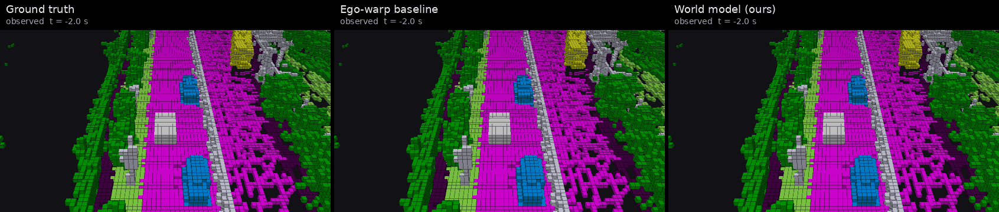
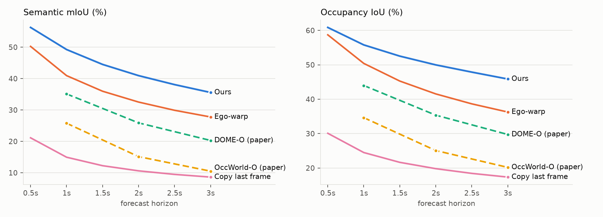
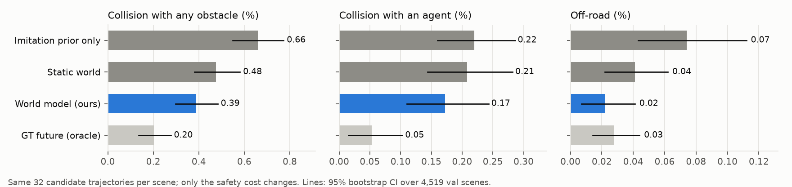
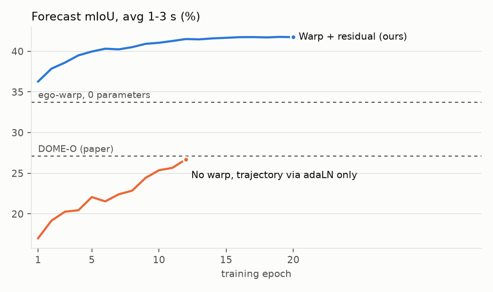
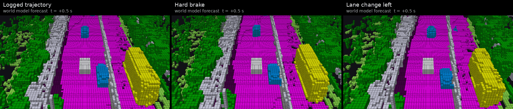
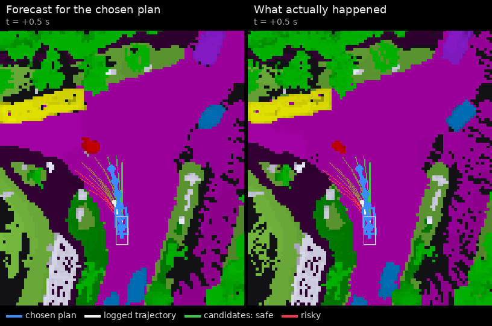
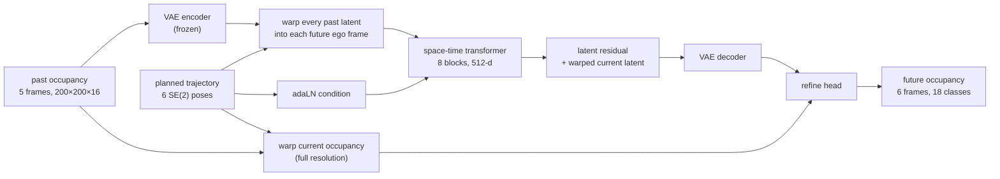

# 4D Occupancy World Model for Planning

A world model that forecasts how the 3D semantic occupancy around a self-driving car evolves over the next 3 seconds, **conditioned on the trajectory the car plans to drive**, and a planner that uses it to reject unsafe trajectories. Trained and evaluated on [Occ3D-nuScenes](https://tsinghua-mars-lab.github.io/Occ3D/).

<p align="center">
  
</p>
<p align="center"><sub>Val scene 0797. Left: what actually happened. Middle: moving the present scene along the planned trajectory, assuming nothing else moves. Right: this model. The two cars driving alongside stay next to the ego only in the world model's forecast; the static-world baseline leaves them behind as if they were parked. White box = ego vehicle.</sub></p>
<p align="center"><sub>More scenes as video: <a href="assets/forecast_all.mp4">forecasts</a> · <a href="assets/whatif_all.mp4">what-if plans</a> · <a href="assets/planning_all.mp4">planning</a></sub></p>

## Results

**4D occupancy forecasting** (Occ3D-nuScenes val, 4,519 windows; 2 s of past occupancy in, 3 s out; ground-truth occupancy as input, same protocol as OccWorld-O and DOME-O):

| Method | Future ego trajectory as input | mIoU 1s / 2s / 3s | **mIoU avg** | IoU 1s / 2s / 3s | **IoU avg** |
|---|:-:|---|:-:|---|:-:|
| Copy last frame | | 14.95 / 10.61 / 8.62 | 11.39 | 24.49 / 19.80 / 17.35 | 20.55 |
| OccWorld-O ([paper](https://arxiv.org/abs/2311.16038)) | predicted | 25.78 / 15.14 / 10.51 | 17.14 | 34.63 / 25.07 / 20.18 | 26.63 |
| DOME-O ([paper](https://arxiv.org/abs/2410.10429)) | ✓ | 35.11 / 25.89 / 20.29 | 27.10 | 43.99 / 35.36 / 29.74 | 36.36 |
| Ego-warp baseline (0 parameters) | ✓ | 40.94 / 32.52 / 27.77 | 33.74 | 50.41 / 41.54 / 36.27 | 42.74 |
| **This model** | ✓ | **49.25 / 40.94 / 35.57** | **41.92** | **55.79 / 49.98 / 45.87** | **50.54** |

Copy-last-frame reproduces the published Copy&Paste row (11.33 / 20.52) to within 0.06, which checks that the evaluation matches the papers'. Training took 1.5 h (tokenizer, 4×A100) plus 3.3 h (world model, 4×H200); DOME reports 2,000 epochs on 32 RTX 4090s.

<p align="center"></p>

**Planning** (same val windows). Every planner picks from the same 32 candidate trajectories per scene; only the safety cost changes. Collision and off-road rates follow the ST-P3 convention (mean over waypoints up to 1/2/3 s, then averaged):

| Planner | L2 to logged (m) | Collision, agents | Collision, any obstacle | Off-road |
|---|:-:|:-:|:-:|:-:|
| Logged human trajectory | 0 | 0 | 0 | 0 |
| Constant velocity | 0.742 | 0.359% | 1.184% | 0.233% |
| Imitation prior only | 0.734 | 0.220% | 0.660% | 0.074% |
| + static-world safety cost | 0.751 | 0.208% | 0.476% | 0.041% |
| **+ world-model safety cost** | **0.736** | **0.172%** | **0.386%** | **0.022%** |
| + GT-future safety cost (oracle) | 0.728 | 0.053% | 0.203% | 0.028% |

<p align="center"></p>

Scoring candidates with the world model cuts obstacle collisions by 42% and off-road events by 70% compared with the imitation prior alone, at no measurable L2 cost. It also beats the static-world cost, which only sees where things are *now*, on every metric. Paired bootstrap over scenes (`results/planning_bootstrap.json`):

- **Obstacle collisions:** world model vs prior, −0.27 points [95% CI 0.18, 0.37]. World model vs static world, −0.09 [0.02, 0.16].
- **Off-road:** world model vs prior, −0.05 [0.02, 0.09].
- **Agent collisions:** the drop from 0.22% to 0.17% is **not significant** [−0.01, 0.10]. Only 48 of 4,519 scenes change, too few to tell.

Across safety weights from 0.5 to 50, the world-model cost always gives fewer obstacle collisions than the static-world cost (`results/planning.json`, `sweep`). The weight used above (5.0) was set when the planner was written and never tuned on val.

## The observation this is built on

Before training anything, I ran a parameter-free baseline: take the current occupancy grid and resample it into each future ego frame along the planned trajectory, assuming the world is static. That **ego-warp scores 33.74 mIoU, ahead of DOME's 27.10**, even though DOME is a diffusion model that receives the same ground-truth trajectory.

In the ego frame, most of what "changes" between now and 3 s from now is the car's own motion. A network that has to learn rigid SE(2) resampling from data spends its capacity on geometry it could have been given. So this model starts from the warp and only learns the correction: other agents moving, and regions that come into view.

<p align="center"></p>

Ablation: the same architecture trained with the warp disabled (trajectory fed only through adaLN conditioning, as in DOME) reaches 26.7 mIoU after 12 epochs, against 41.5 with the warp at the same epoch. Same data, same batch size, same validation subset. The no-warp run lands right around DOME's number, which suggests the gap comes from where the trajectory enters the model, not from model size or training budget.

## Does the forecast follow the plan?

A world model is only useful for planning if its future depends on the action. Same 2 s of history, three different plans:

<p align="center"></p>
<p align="center"><sub>Under hard braking, the cars that were alongside pull ahead of the ego. Under a lane change, the scene shifts and the neighbouring car ends up ahead and to the right.</sub></p>

## How the planner uses it

<p align="center"></p>
<p align="center"><sub>Thin lines: the 32 candidates, coloured by predicted collision risk (green safe, red risky). Blue: chosen plan. White: what the human driver did. The left-curving candidates head toward a pedestrian (red) and get rejected.</sub></p>

1. **Candidates.** A 256-trajectory vocabulary from k-means over logged 3 s futures. An imitation prior (a small conv net over the current scene latent plus recent ego motion) scores all of them; the top 32 are kept.
2. **Rollout.** The world model forecasts 3 s of occupancy for all 32 candidates in one batch. Each forecast is in that candidate's own future ego frames, so the ego box always sits at the grid centre and the collision check is a fixed voxel lookup.
3. **Cost.** `−log p_prior + 5 · max_t P(obstacle in ego box) + 1 · P(non-drivable surface under ego)`. Lowest cost wins.

Costs are decoded only for a 25.6 m crop around the ego. The full planning step (prior, 32 rollouts, costs) takes about 0.5 s per scene on one L40S, unoptimised.

## Architecture



- **Tokenizer.** A VAE folds the 16 height cells of each column into channels and compresses the grid to a 50×50×32 BEV latent. Reconstruction on all 6,019 val frames: **88.5 mIoU / 78.7 IoU** (DOME's VAE: 83.1 / 77.3; OccWorld's VQ-VAE: 66.4 / 62.3).
- **Warping.** For each future pose, all five past latents are resampled into that future ego frame (`grid_sample`, SE(2)). Static structure lines up across time; moving agents show up as trails the transformer can read.
- **Transformer.** Factorised spatial attention (625 tokens per frame) and temporal attention (per cell), with adaLN-zero conditioning on future poses, per-step motion and past ego poses. It predicts a residual on the warped current latent.
- **Refine head.** The decoded voxel features are fused at full resolution with a one-hot of the warped current occupancy, through a learned per-class skip. Static detail is copied, not squeezed through the latent, and at initialisation the model reproduces the ego-warp exactly. Training starts at 33.7 mIoU, not 0.
- **Losses.** Cross-entropy + Lovász-softmax on the voxels, plus MSE between predicted and encoded future latents. 57 M trainable parameters plus the fine-tuned decoder.

## Evaluation details that matter

- **Forecasting protocol.** OccWorld's: classes 0–16 in mIoU (everything but `free`), no camera mask, IoU of occupied vs free, counts accumulated over the split. The 1/2/3 s numbers are future frames 2/4/6 at 2 Hz.
- **No raw nuScenes.** Downloading raw nuScenes needs an account, so this project only uses the Occ3D labels and ego poses, which are publicly mirrored. Without nuScenes boxes, collisions are checked against **ground-truth occupancy voxels** in the body height band (0.6–1.8 m). They are not comparable to box-based collision rates in other papers; compare rows within the table above, not across papers.
- **Metric sanity.** A first version of the planning metrics flagged the logged human trajectory as colliding on 1.9% of waypoints and off-road 12% of the time. Three causes, all fixed (commit `873e8b6`):
  - Occ3D never observes the ground under the ego, so "no road label" is not "off-road". Off-road now needs positive evidence of sidewalk, terrain, vegetation or other-flat.
  - Kerbs and sloped road reach into the lowest body cell, so the band starts at 0.6 m.
  - About 2% of frames have stray labels inside the ego's own box; those cells are ignored.
- **Slices.** By maneuver, obstacle collisions drop from 0.65% to 0.41% going straight (3,403 scenes), 1.63% to 0.40% on right turns (217) and 1.39% to 0.76% on left turns (180). On left turns, agent collisions get *worse* (0.20% to 0.39%). With 180 scenes that may be noise, but I haven't ruled it out. Full breakdown in `results/planning.json`.

## Limitations

- **Open-loop.** Plans are scored on logged data and never executed. A closed-loop simulator would be needed to show the planner actually drives better.
- **Perfect perception.** The model takes ground-truth past occupancy as input, like the -O variants of OccWorld and DOME. A camera- or lidar-based occupancy predictor would sit in front of it in a real stack.
- **Deterministic.** The model predicts one future per plan. Uncertainty shows up as soft probabilities, not as distinct modes.
- **Ego-status shortcut.** The imitation prior uses recent ego motion, which is known to dominate open-loop nuScenes L2 ([Li et al., 2024](https://arxiv.org/abs/2312.03031)). The L2 column is not a claim; the claim is the collision reduction at equal L2, with identical candidates.
- **Unobserved areas.** Regions never seen in the past (e.g. around a sharp turn) are forecast as empty more often than they should be.

## Reproducing

```bash
# Environment (Python 3.11, CUDA 12.8)
pip install torch==2.8.0 --index-url https://download.pytorch.org/whl/cu128
pip install -r requirements.txt

# Data: Occ3D-nuScenes labels + annotations (ego poses, split), ~2.9 GB
mkdir -p data/occ3d && cd data/occ3d
for f in annotations.json gts.tar.gz; do
  curl -L -o $f https://huggingface.co/datasets/RoyYao233/occ3d-nuscenes-transfer/resolve/main/$f
done
tar xzf gts.tar.gz && cd ../..
python scripts/prepare_data.py --root data/occ3d        # packs 34,149 frames into a memmap

# Baselines (no training)
python scripts/eval_forecast.py --method copy --data data/occ3d/packed
python scripts/eval_forecast.py --method warp --data data/occ3d/packed

# Train: tokenizer -> world model, imitation prior (torchrun works for all three)
torchrun --nproc_per_node 4 scripts/train_vae.py --data data/occ3d/packed --out runs/vae
torchrun --nproc_per_node 4 scripts/train_wm.py  --data data/occ3d/packed --vae runs/vae/best.pt --out runs/wm
python scripts/train_prior.py --data data/occ3d/packed --vae runs/vae/best.pt --out runs/prior

# Evaluate, plot, render
python scripts/eval_forecast.py --method model --ckpt runs/wm/best.pt --name ours --data data/occ3d/packed
python scripts/eval_planning.py --wm runs/wm/best.pt --prior runs/prior/best.pt --data data/occ3d/packed
python scripts/plot_results.py
python scripts/make_media.py forecast --wm runs/wm/best.pt --data data/occ3d/packed
```

SLURM wrappers are in `slurm/` (`STAGE=vae sbatch slurm/train.sbatch`, `slurm/eval.sbatch`). Unit tests for the geometry, metrics and collision checks run on CPU without data: `pytest tests`.

## Repository layout

```
occwm/
  data.py            memmapped Occ3D sequences, SE(2) pose index
  geometry.py        SE(2) poses, BEV / voxel warping
  models/vae.py      occupancy tokenizer
  models/world_model.py   warp + residual world model
  models/prior.py    imitation prior over the trajectory vocabulary
  planning.py        trajectory vocabulary, collision / off-road checks, costs
  metrics.py         OccWorld-protocol IoU, ST-P3 L2 / collision conventions
  render.py          GPU voxel ray caster used for every 3D figure
scripts/             data prep, training, evaluation, plots, media
results/             all numbers quoted in this README, as JSON
tests/               geometry, metric and planning unit tests
```

## References

- Tian et al., *Occ3D: A Large-Scale 3D Occupancy Prediction Benchmark for Autonomous Driving*, NeurIPS 2023.
- Zheng et al., *OccWorld: Learning a 3D Occupancy World Model for Autonomous Driving*, ECCV 2024.
- Gu et al., *DOME: Taming Diffusion Model into High-Fidelity Controllable Occupancy World Model*, 2024.
- Hu et al., *ST-P3: End-to-end Vision-based Autonomous Driving via Spatial-Temporal Feature Learning*, ECCV 2022.
- Li et al., *Is Ego Status All You Need for Open-Loop End-to-End Autonomous Driving?*, CVPR 2024.
